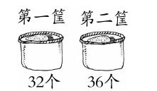

# Mathematics (Grade 6)

**ID**: f095b012
**难度**: medium_hard
**题型**: fill_in_the_blank

## 题目
从第二筐中拿出（）个放入第一筐，两筐的个数就一样多了。

## 解答

**答案**: 2

1. Step1:计算第二筐比第一筐多的个数，即36 - 32 = 4个
2. Step2:将多出来的4个平均分成两份，因为4 = 2 + 2，所以每份是2个
3. Step3:得出从第二筐中拿出2个放入第一筐，两筐个数就一样多了

## 知识点

**知识点**:
  - 整数的加法和减法

---
