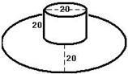

# Mathematics (Grade 6)

**ID**: f1973825
**难度**: medium_hard
**题型**: fill_in_the_blank

## 题目
为了参加“六一”儿童节的服装表演，王宇同学准备自己动手用硬纸片做个礼帽（如图）．请你帮他计算一下，他至少要用硬纸片$\underline{\hspace{5em}}$平方厘米．

## 解答

**答案**: 4082

1. Step1:计算大圆半径，20 + 20÷2 = 30厘米
2. Step2:根据圆面积公式S = πr²，计算大圆面积为3.14×30² = 3.14×900 = 2826平方厘米
3. Step3:根据圆柱侧面积公式S = 底面圆周长×高，底面圆周长为3.14×20，高为20，计算圆柱侧面积为3.14×20×20 = 3.14×400 = 1256平方厘米
4. Step4:计算总面积，将大圆面积和圆柱侧面积相加，2826 + 1256 = 4082平方厘米

## 知识点

**知识点**:
  - 关于圆柱的应用题；有关圆的应用题．

---
