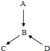

# Mathematics (Grade 6)

**ID**: f3ab4bd9
**难度**: medium_hard
**题型**: fill_in_the_blank

## 题目
图中，A→B表示数A比数B小，那么A、B、C、D四个数中最大的是C．$\underline{\hspace{5em}}$（判断对错）

## 解答

**答案**: √

1. Step1:由A→B可知A＜B
2. Step2:由B→C可知B＜C
3. Step3:由A＜B和B＜C可推出A＜B＜C
4. Step4:由B→D可知D＜B
5. Step5:由D＜B和B＜C可推出D＜C
6. Step6:综合A＜B＜C和D＜C，得出C是A、B、C、D四个数中最大的，判断答案为√

## 知识点

**知识点**:
  - 逻辑推理．

---
