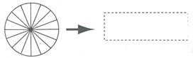

# Mathematics (Grade 6)

**ID**: f5b3c392
**难度**: medium_hard
**题型**: fill_in_the_blank

## 题目
圆的面积计算公式可以通过把圆转化成长方形推导出来（如图）．下面这个圆转化成长方形后，长方形的周长比圆的周长多10厘米，圆的面积是$\underline{\hspace{5em}}$平方厘米．

## 解答

**答案**: 78.5

1. Step1:根据‘长方形的周长比圆的周长多10厘米，且长方形的周长比圆的周长多1条直径的长’，可知圆的直径为10厘米
2. Step2:由圆的直径为10厘米，计算圆的半径，10÷2 = 5厘米
3. Step3:根据圆的面积公式S = πr²，其中π取3.14，r = 5厘米，计算圆的面积，即3.14×5² = 78.5平方厘米

## 知识点

**知识点**:
  - 圆、圆环的面积．

---
