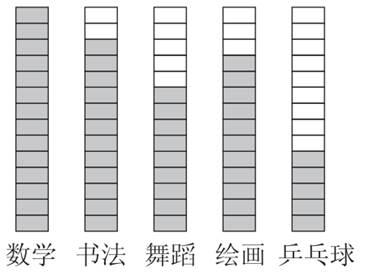

# Mathematics (Grade 6)

**ID**: f97dd605
**难度**: medium_hard
**题型**: fill_in_the_blank

## 题目
下面是亮亮调查的一(6)班同学的爱好统计图。

（1）将统计图中的数据填入下表。
$\begin{array}{|c|c|c|c|c|c|}
\hline
 & 数学
 & 书法
 & 舞蹈
 & 绘画
 & 乒乓球
 \\\hline
人数（人）
 &  
 &  
 &  
 &  
 &  
 \\\hline
\end{array}$
（2）爱好(   )的人数最多，爱好(   )的人数最少。
（3）爱好数学的人数比爱好乒乓球的人数多(  )人。

## 解答

**答案**: 14, 12, 9, 11, 5, 数学, 乒乓球, 9

1. Step1:观察统计图，数出爱好数学的人数对应的方格数为14个，所以爱好数学的人数是14人
2. Step2:数出爱好书法的人数对应的方格数为12个，所以爱好书法的人数是12人
3. Step3:数出爱好舞蹈的人数对应的方格数为9个，所以爱好舞蹈的人数是9人
4. Step4:数出爱好绘画的人数对应的方格数为11个，所以爱好绘画的人数是11人
5. Step5:数出爱好乒乓球的人数对应的方格数为5个，所以爱好乒乓球的人数是5人
6. Step6:比较14、12、9、11、5的大小，14最大，5最小，所以爱好数学的人数最多，爱好乒乓球的人数最少
7. Step7:用爱好数学的人数14减去爱好乒乓球的人数5，14 - 5 = 9，所以爱好数学的人数比爱好乒乓球的人数多9人
8. Step8:将上述结果按顺序整理为['14', '12', '9', '11', '5', '数学', '乒乓球', '9']

## 知识点

**知识点**:
  - 小学数学;统计和概率;统计;数据的搜集与整理;统计图表的综合应用

---
