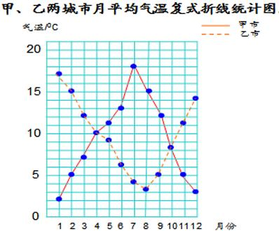

# Mathematics (Grade 6)

**ID**: fda57e1e
**难度**: medium_hard
**题型**: fill_in_the_blank

## 题目
根据下面的统计图，回答问题。

（1）最高月平均气温甲市出现在（   ）月，乙市出现在（   ）月。
（2）两城市最高月平均气温相差（   ）℃ 。
（3）（   ）月份两城市月平均气温相同，有（   ）个月乙市月平均气温高于甲市，其余（   ）个月乙市月平均气温低于甲市。
（4）分别说一说两城市月平均气温如何变化的。
（5）从总体上看，两城市月平均气温最明显的差别是什么？

## 解答

**答案**: 七月, 一月, 1, 四月和十月, 5, 5, 甲城市气温先升高再降低乙城市气温先降低再升高, 甲城市是七月份温度最高，乙城市是一月份温度最高，两者温度差异较明显。

1. Step1:观察统计图，找到甲市折线最高点对应的月份，得出甲市最高月平均气温出现在七月
2. Step2:观察统计图，找到乙市折线最高点对应的月份，得出乙市最高月平均气温出现在一月
3. Step3:找到甲市最高月平均气温和乙市最高月平均气温的数值，计算差值，得出两城市最高月平均气温相差1℃
4. Step4:观察统计图，找出两城市折线相交的月份，得出四月和十月两城市月平均气温相同
5. Step5:观察统计图，统计乙市折线在甲市折线上方的月份数量，得出有5个月乙市月平均气温高于甲市
6. Step6:观察统计图，统计乙市折线在甲市折线下方的月份数量，得出其余5个月乙市月平均气温低于甲市
7. Step7:观察甲市折线的走势，描述甲城市气温变化为气温先升高再降低
8. Step8:观察乙市折线的走势，描述乙城市气温变化为气温先降低再升高
9. Step9:对比两城市最高气温出现的月份，总结从总体上看两城市月平均气温最明显的差别是甲城市是七月份温度最高，乙城市是一月份温度最高，两者温度差异较明显

## 知识点

**知识点**:
  - 小学数学;统计和概率;统计;统计图;复式折线统计图;统计图表的综合应用

---
