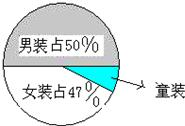

# Mathematics (Grade 6)

**ID**: fdbc6f50
**难度**: medium_hard
**题型**: fill_in_the_blank

## 题目
如图是一个扇形统计图，从图中可以看出童装占百分之几？如果女装有94件，那么男装有多少件？

## 解答

**答案**: 3%, 100

1. Step1:把男、女、童装的总量看作单位'1'，计算童装所占百分率，用1减去男装占的50%和女装占的47%，即1 - 50% - 47% = 3%
2. Step2:已知女装有94件，女装占47%，根据百分数除法的意义，计算男、女、童装的总件数，94÷47% = 200件
3. Step3:已知男装占50%，根据百分数乘法的意义，用总件数200乘男装所占的50%，计算男装的件数，200×50% = 100件

## 知识点

**知识点**:
  - 扇形统计图．

---
