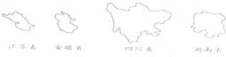

# Mathematics (Grade 6)

**ID**: 00d734cb
**难度**: medium_hard
**题型**: multiple_choice

## 题目
如图是从一幅中国地图上描下来的四个省的图形．其中安徽省的面积大约是13.97万平方千米，（  ）省面积大约是它的150%．
$\begin{description}
\item A．湖南省\item B．四川省\item C．江苏省
\end{description}$

## 解答

**答案**: A

1. Step1:将150%转化为小数，150% = 1.5，明确问题是求哪个省面积大约是安徽省面积的1.5倍
2. Step2:根据图形大小，判断江苏省与安徽省面积差不多
3. Step3:根据图形大小，判断四川省面积大约为安徽省面积的4倍
4. Step4:根据前面的判断，得出只有湖南省面积符合大约是安徽省面积1.5倍的条件
5. Step5:确定答案为湖南省，即选项A

## 知识点

**知识点**:
  - 百分数的实际应用．

---
