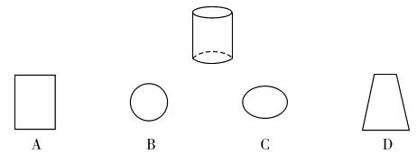

# Mathematics (Grade 6)

**ID**: 027ca558
**难度**: medium_hard
**题型**: multiple_choice

## 题目
用一个平面去截下图所示的圆柱，不可能的截面是（）。

## 解答

**答案**: D

1. Step1:考虑截面与轴截面平行的情况，此时得到的截面形状为长方形
2. Step2:考虑截面与轴截面垂直的情况，此时得到的截面形状是圆
3. Step3:考虑截面与轴截面斜交的情况，此时得到的截面的形状是椭圆
4. Step4:考虑截面经过上下底面与轴截面有夹角的情况，所得截面是上下边平行，两条腰是曲线的图形
5. Step5:综上，截面形状不可能是等腰梯形，所以答案选D

## 知识点

**知识点**:
  - 截面

---
