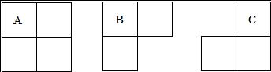

# Mathematics (Grade 6)

**ID**: 04abfd3b
**难度**: medium_hard
**题型**: multiple_choice

## 题目
如图图形周长比较（  ）

A．A长
B．B长
C．一样长

## 解答

**答案**: C

1. Step1:设小正方形的边长为1
2. Step2:计算A的周长，根据正方形周长计算方法可得2×4=8
3. Step3:计算B的周长，其等于边长是2的正方形的周长，即2×4=8
4. Step4:计算C的周长，其等于边长是2的正方形的周长，即2×4=8
5. Step5:比较A、B、C的周长，发现它们都为8，所以周长一样长，答案选C

## 知识点

**知识点**:
  - 正方形的周长．

---
