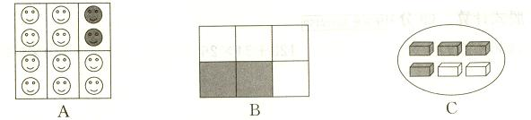

# Mathematics (Grade 6)

**ID**: 04ad2b1d
**难度**: medium_hard
**题型**: multiple_choice

## 题目
下列各图中的阴影部分能用$\frac{2}{6}$表示的是（）。

## 解答

**答案**: B

1. Step1:观察A图，其被分为6个相同部分，阴影部分占1份，根据分数的意义，用分数$rac{1}{6}$表示
2. Step2:观察B图，其被分为6个相同部分，阴影部分占2份，根据分数的意义，用分数$rac{2}{6}$表示
3. Step3:观察C图，其被分为6个部分，阴影部分占4份，根据分数的意义，用分数$rac{4}{6}$表示
4. Step4:题目要求找出阴影部分能用$rac{2}{6}$表示的图，对比可知是B图

## 知识点

**知识点**:
  - 分数的初步认识

---
