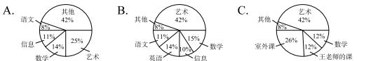

# Mathematics (Grade 6)

**ID**: 050c8b9e
**难度**: medium_hard
**题型**: multiple_choice

## 题目
下面是同学们最喜欢的课程的统计图，（）比较合理。

## 解答

**答案**: B

1. Step1:明确题目是要从统计图中选出比较合理的一个
2. Step2:知道扇形统计图用整个圆面积表示总数量，扇形面积表示各部分数量，能反映各部分与整体关系
3. Step3:结合实际，判断语文、数学、英语三科喜欢度应差不多
4. Step4:观察选项，发现选项B中语文、数学、英语所占比例较为接近，所以选项B比较合理

## 知识点

**知识点**:
  - 扇形统计图的认识及绘制

---
