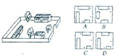

# Mathematics (Grade 6)

**ID**: 07628150
**难度**: medium_hard
**题型**: multiple_choice

## 题目
如图是一户农家小院．从上向下看，右边四幅图哪一幅是正确的？

## 解答

**答案**: C

1. Step1:明确实物图特征，有3排房子，3棵树
2. Step2:分析图片A，发现有一棵树的位置与实物图不相符
3. Step3:分析图片B，发现其中的3棵树与实物图都不相符
4. Step4:分析图片C，发现其3排房子，3棵树与实物图相符
5. Step5:分析图片D，发现与实物图相比少了1棵树
6. Step6:根据上述分析，确定正确的是图片C

## 知识点

**知识点**:
  - 从不同方向观察物体和几何体．

---
