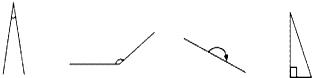

# Mathematics (Grade 6)

**ID**: 08790064
**难度**: medium_hard
**题型**: multiple_choice

## 题目
根据图中依次描述，正确的答案是（  ）

$\begin{description}
\item A．锐角、钝角、周角、直角\item B．锐角、钝角、直角、平角\item C．锐角、钝角、平角、直角
\end{description}$

## 解答

**答案**: C

1. Step1:明确角的分类标准，小于90°的角是锐角，等于90°的角是直角，大于90°且小于180°的角是钝角，等于180°的角是平角，等于360°的角是周角
2. Step2:观察图中第一个角，其小于90°，根据分类标准可知是锐角
3. Step3:观察图中第二个角，其大于90°且小于180°，根据分类标准可知是钝角
4. Step4:观察图中第三个角，其等于180°，根据分类标准可知是平角
5. Step5:观察图中第四个角，其等于90°，根据分类标准可知是直角
6. Step6:将观察结果与选项对比，得出正确答案为C

## 知识点

**知识点**:
  - 角的概念及其分类．

---
