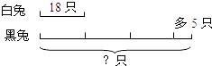

# Mathematics (Grade 6)

**ID**: 09fd1135
**难度**: medium_hard
**题型**: multiple_choice

## 题目
根据线段图列出的算式是（  ） 

A．18×3+5
B．18×3﹣5
C．（18﹣5）÷3

## 解答

**答案**: A

1. Step1:观察线段图可知白兔有18只
2. Step2:从图中还能得出黑兔比白兔的3倍多5只
3. Step3:根据乘法意义，白兔的3倍可表示为18×3只
4. Step4:依据加法意义，黑兔数量为白兔的3倍加上5只，即18×3 + 5只
5. Step5:所以列出的算式是18×3 + 5，答案选A

## 知识点

**知识点**:
  - 小学数学;数与代数;应用题;复合应用题

---
