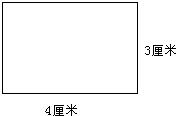

# Mathematics (Grade 6)

**ID**: 0c8a00b1
**难度**: medium_hard
**题型**: multiple_choice

## 题目
如图，计算这个长方形的周长正确的方法是（  ）
A．4+3
B．4×3
C．4+3×2
D．4+3+4+3

## 解答

**答案**: D

1. Step1:明确长方形周长的定义为长方形一周的长度，即 2 个长加 2 个宽
2. Step2:已知该长方形长为 4 厘米，宽为 3 厘米
3. Step3:根据长方形周长公式，其周长可表示为（长 + 宽）×2，即（4 + 3）×2
4. Step4:其周长也可表示为 2 个长加 2 个宽，即 4 + 4 + 3 + 3，也就是 4 + 3 + 4 + 3
5. Step5:对比选项，发现 D 选项 4 + 3 + 4 + 3 符合长方形周长的计算方法

## 知识点

**知识点**:
  - 长方形的周长．

---
