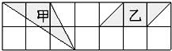

# Mathematics (Grade 6)

**ID**: 0d415f91
**难度**: medium_hard
**题型**: multiple_choice

## 题目
如图，甲的阴影面积（  ）乙的阴影面积．

$\begin{description}
\item A．大于\item B．小于\item C．等于
\end{description}$

## 解答

**答案**: C

1. Step1:明确甲是三角形，其底为2个小正方形边长，高为2个小正方形边长
2. Step2:根据三角形面积公式S = 底×高÷2，计算甲的面积为2×2÷2 = 2
3. Step3:明确乙是平行四边形，其底为2个小正方形边长，高为1个小正方形边长
4. Step4:根据平行四边形面积公式S = 底×高，计算乙的面积为2×1 = 2
5. Step5:比较甲和乙的面积，得出甲的面积等于乙的面积

## 知识点

**知识点**:
  - 面积及面积的大小比较．

---
