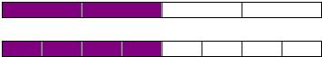

# Mathematics (Grade 6)

**ID**: 0d7a0575
**难度**: medium_hard
**题型**: multiple_choice

## 题目
$\frac{2}{4}()\frac{4}{8}$

A．＜
B．=
C．＞
D．无法比较

## 解答

**答案**: B

1. Step1:明确要比较的两个分数为$\frac{2}{4}$和$\frac{4}{8}$
2. Step2:分析$\frac{2}{4}$，它表示把一个整体平均分成4份，取其中的2份
3. Step3:分析$\frac{4}{8}$，它表示把一个整体平均分成8份，取其中的4份
4. Step4:根据所给图形，两根同样长的木棒，第一根对应$\frac{2}{4}$的涂色部分和第二根对应$\frac{4}{8}$的涂色部分长度相同
5. Step5:得出$\frac{2}{4}=\frac{4}{8}$，所以应选B

## 知识点

**知识点**:
  - 分数大小的比较．

---
