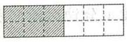

# Mathematics (Grade 6)

**ID**: 0e41b54b
**难度**: medium_hard
**题型**: multiple_choice

## 题目

   中的阴影部分不能用(    )表示
   A．
   $\frac{1}{2}$
   B．
   $\frac{2}{4}$
   C．
   $\frac{6}{8}$
   D．
   $\frac{3}{6}$

## 解答

**答案**: C

1. Step1:数出图形被平均分成了12份
2. Step2:确定阴影部分占了6份，得出阴影部分占比为6/12
3. Step3:将6/12进行约分，得到1/2
4. Step4:分别对选项中的分数进行分析，A选项1/2与阴影部分占比相等；B选项2/4约分后为1/2，与阴影部分占比相等；C选项6/8约分后为3/4，与阴影部分占比不相等；D选项3/6约分后为1/2，与阴影部分占比相等
5. Step5:得出阴影部分不能用C选项6/8表示

## 知识点

**知识点**:
  - 第八、九单元整理和复习-综合能力测试
-

---
