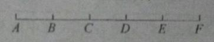

# Mathematics (Grade 6)

**ID**: 0f672579
**难度**: medium_hard
**题型**: multiple_choice

## 题目
如图，AB＝BC＝CD＝DE＝EF，下面的三个比例式中，哪几个正确？

 ①AB:AC=BD:BF
 ②AC:BC=DE:AD
 ③BE:CE=AD:BD

## 解答

**答案**: ①

1. Step1:设AB＝BC＝CD＝DE＝EF = 1
2. Step2:计算AC = AB + BC = 1 + 1 = 2，BD = BC + CD = 1 + 1 = 2，BF = BC + CD + DE + EF = 1 + 1 + 1 + 1 = 4，得出AB:AC = 1:2，BD:BF = 2:4 = 1:2，所以AB:AC = BD:BF，①正确
3. Step3:计算AC = 2，BC = 1，DE = 1，AD = AB + BC + CD = 1 + 1 + 1 = 3，得出AC:BC = 2:1，DE:AD = 1:3，所以AC:BC ≠ DE:AD，②错误
4. Step4:计算BE = BC + CD + DE = 1 + 1 + 1 = 3，CE = CD + DE = 1 + 1 = 2，AD = 3，BD = 2，得出BE:CE = 3:2，AD:BD = 3:2，所以BE:CE = AD:BD，③正确
5. Step5:综上，正确的是①③，答案为['①']

## 知识点

**知识点**:
  - 

---
