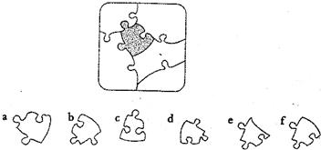

# Mathematics (Grade 6)

**ID**: 0f83e114
**难度**: medium_hard
**题型**: multiple_choice

## 题目
下面给出的六块拼图中，哪几块与阴影部分的形状不相同？

## 解答

**答案**: c

1. Step1:观察阴影部分的形状特征
2. Step2:依次观察a、b、c、d、e、f六块拼图的形状
3. Step3:对比发现c的形状比阴影部分多缺了一块
4. Step4:尝试对a、b、d、e、f进行旋转，发现可得出与阴影部分形状相同的图形
5. Step5:确定c与阴影部分的形状不相同

## 知识点

**知识点**:
  - 图形的拼组．

---
