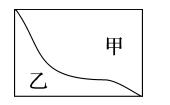

# Mathematics (Grade 6)

**ID**: 11c11a7a
**难度**: medium_hard
**题型**: multiple_choice

## 题目
右图中，甲、乙两部分的周长（）

A.甲长
B.乙长
C.相等
D.无法比较

## 解答

**答案**: C

1. Step1:明确长方形特征，长方形有4条边，对边平行且相等
2. Step2:观察图形，发现甲、乙各有一组长方形的相邻的边
3. Step3:根据长方形对边相等，得出甲、乙这两组相邻边的和是相等的
4. Step4:看到把甲、乙分开的中间一条线是甲乙所共有的
5. Step5:综合上述情况，得出甲乙两部分的周长相等，答案选C

## 知识点

**知识点**:
  - 长方形的认识;长方形与正方形的周长

---
