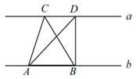

# Mathematics (Grade 6)

**ID**: 11cafaa8
**难度**: medium_hard
**题型**: multiple_choice

## 题目
已知直线$\textit{a}$平行于直线$\textit{b}$，三角形$\textit{ABC}$与三角形$\textit{ABD}$的面积相比，_________．

A．三角形\textit{ABC}面积大
B．三角形\textit{ABD}面积大
C．面积一样大
D．面积大小无法确定

## 解答

**答案**: C

1. Step1:因为直线a平行于直线b，所以三角形ABC与三角形ABD的高相等，它们的高是两条平行线a和b之间的距离
2. Step2:三角形ABC与三角形ABD有共同的底边AB
3. Step3:根据三角形面积公式S = 1/2×底×高，由于底相同，高也相同，所以它们的面积一样大
4. Step4:故答案选C

## 知识点

**知识点**:
  - 小学数学;图形与几何;平面图形;长方形和正方形;面积认识及大小的比较

---
