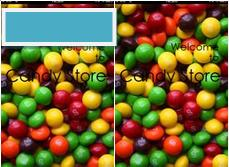

# Mathematics (Grade 6)

**ID**: 1396ed57
**难度**: medium_hard
**题型**: multiple_choice

## 题目
如图，被遮起来的糖果大约是20粒，这些糖果一共大约（  ）粒．

A．100
B．1000
C．200
D．500

## 解答

**答案**: C

1. Step1:观察图可知糖果被平均分成两份，被遮起来的糖果大约占一份中的1/5，其数量为20粒
2. Step2:根据被遮糖果占一份的比例和数量，计算一份糖果的数量，20÷(1/5)=100粒
3. Step3:因为糖果共两份，计算糖果总数，100×2=200粒

## 知识点

**知识点**:
  - 数的估算．

---
