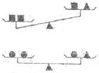

# Mathematics (Grade 6)

**ID**: 14012df8
**难度**: medium_hard
**题型**: multiple_choice

## 题目
设“●”“▲”“■”表示三种不同的物体，现用天平称了两次，情况如图所示，那么●、▲、■这三个物体按质量从大到小的顺序排列为（  ）
A．■、●、▲
B．■、▲、●
C．▲、●、■
D．▲、■、●

## 解答

**答案**: A

1. Step1:观察第一次天平称重情况，得出■+■＞■+▲，两边同时减去一个■，得到■＞▲
2. Step2:观察第二次天平称重情况，得出●+●＜●+▲，两边同时减去一个●，得到●＜▲
3. Step3:综合上述两个结论，可知■＞▲且●＜▲，所以三个物体按质量从大到小的顺序为■、●、▲，答案选A

## 知识点

**知识点**:
  - 比较大小．

---
