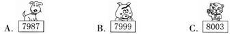

# Mathematics (Grade 6)

**ID**: 16d8611c
**难度**: medium_hard
**题型**: multiple_choice

## 题目
下面（）最接近8000。

## 解答

**答案**: B

1. Step1:计算7987与8000的差值，8000 - 7987 = 13
2. Step2:计算7999与8000的差值，8000 - 7999 = 1
3. Step3:计算8003与8000的差值，8003 - 8000 = 3
4. Step4:比较差值大小，1＜3＜13
5. Step5:得出结论，差值最小的7999最接近8000，答案为B

## 知识点

**知识点**:
  - 万以内数的加减法

---
