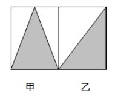

# Mathematics (Grade 6)

**ID**: 176f66ab
**难度**: medium_hard
**题型**: multiple_choice

## 题目
图中，边长相等的两个正方形中，画了甲、乙两个三角形（用阴影表示），它们的面积比（）

A.甲的面积大
B.乙的面积大
C.相等

## 解答

**答案**: C

1. Step1:明确三角形面积公式为三角形的面积=底×高÷2
2. Step2:观察图形可知甲、乙两个三角形的底都等于正方形的边长
3. Step3:观察图形可知甲、乙两个三角形的高都等于正方形的边长
4. Step4:因为两个正方形边长相等，所以甲、乙两个三角形的底和高都分别相等
5. Step5:根据三角形面积公式，底和高分别相等的两个三角形面积相等，所以甲、乙两个三角形面积相等，答案选C

## 知识点

**知识点**:
  - 三角形的面积

---
