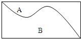

# Mathematics (Grade 6)

**ID**: 18a85b2b
**难度**: medium_hard
**题型**: multiple_choice

## 题目
下面说话正确的是(  )

A．周长相等面积不等
B．周长和面积都不相等
C．周长不相等面积相等

## 解答

**答案**: A

1. Step1:明确周长的定义为封闭图形一周的长度，面积是一个图形所占平面的大小
2. Step2:观察图形A和图形B，比较其面积大小，发现图形B明显比图形A大，即图形A的面积＜图形B的面积
3. Step3:分析图形A和图形B的周长组成，均是一个曲线的长度加上一个长和宽，所以图形A的周长等于图形B的周长
4. Step4:根据前面得出的面积和周长的比较结果，判断选项A“周长相等面积不等”正确

## 知识点

**知识点**:
  - 面积及面积的大小比较;长度比较．

---
