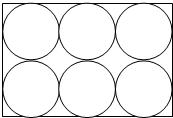

# Mathematics (Grade 6)

**ID**: 1a9ee9bc
**难度**: medium_hard
**题型**: multiple_choice

## 题目
图中六个圆的半径都是4三m，那么图中长方形的面积为（  ）
$\begin{description}
\item A．96cm^{2}\item B．196 cm^{2}\item C．192 cm^{2}\item D．384 cm^{2}
\end{description}$

## 解答

**答案**: C

1. Step1:根据题意可知长方形的长等于圆的6个半径，因为圆半径是4厘米，所以长方形长为6×4 = 24厘米
2. Step2:根据题意可知长方形的宽等于圆的2个半径，因为圆半径是4厘米，所以长方形宽为2×4 = 8厘米
3. Step3:根据长方形面积公式，面积等于长乘宽，所以长方形面积为24×8 = 192平方厘米

## 知识点

**知识点**:
  - 长方形、正方形的面积．

---
