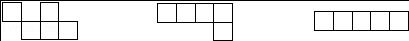

# Mathematics (Grade 6)

**ID**: 1b1ec8c6
**难度**: medium_hard
**题型**: multiple_choice

## 题目
用5个1平方厘米的正方形，拼成下面的图形，他们的面积相比，（ ）

$\begin{description}
\item A．第一个图形大\item B．第二个图形大\item C．一样大
\end{description}$

## 解答

**答案**: C

1. Step1:明确每个正方形面积为1平方厘米
2. Step2:知道是用5个这样的正方形拼图形
3. Step3:根据面积计算方法，可得拼成图形面积为1×5 = 5平方厘米
4. Step4:得出无论拼成哪种图形，面积都一样大，所以选C

## 知识点

**知识点**:
  - 

---
