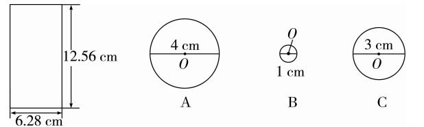

# Mathematics (Grade 6)

**ID**: 1b673262
**难度**: medium_hard
**题型**: multiple_choice

## 题目
如下图，用左边的长方形纸围成圆柱，（）恰好能做圆柱的底面。

## 解答

**答案**: A

1. Step1:明确长方形纸围成圆柱时，圆柱底面周长可能是长方形的长或宽
2. Step2:当底面周长为长方形的长12.56cm时，根据d = c÷3.14，可得直径d = 12.56÷3.14 = 4cm
3. Step3:当底面周长为长方形的宽6.28cm时，根据d = c÷3.14，可得直径d = 6.28÷3.14 = 2cm
4. Step4:对比选项，A选项圆的直径为4cm，符合上述计算结果，所以选A

## 知识点

**知识点**:
  - 圆柱的认识

---
