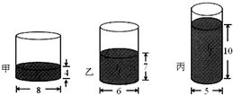

# Mathematics (Grade 6)

**ID**: 1bb603a3
**难度**: medium_hard
**题型**: multiple_choice

## 题目
下面（  ）杯中的饮料最多（单位：厘米）．

A．甲
B．乙
C．丙

## 解答

**答案**: A

1. Step1:根据圆柱体积公式圆柱的体积 = πr²h，计算甲杯饮料体积，r = 8÷2 = 4 厘米，h = 4 厘米，体积为 3.14×（8÷2）²×4 = 3.14×16×4 = 3.14×64 立方厘米
2. Step2:根据圆柱体积公式计算乙杯饮料体积，r = 6÷2 = 3 厘米，h = 7 厘米，体积为 3.14×（6÷2）²×7 = 3.14×9×7 = 3.14×63 立方厘米
3. Step3:根据圆柱体积公式计算丙杯饮料体积，r = 5÷2 = 2.5 厘米，h = 10 厘米，体积为 3.14×（5÷2）²×10 = 3.14×6.25×10 = 3.14×62.5 立方厘米
4. Step4:比较三个杯子饮料体积大小，因为 64＞63＞62.5，所以甲杯中的饮料最多，答案选 A

## 知识点

**知识点**:
  - 圆柱的侧面积、表面积和体积．

---
