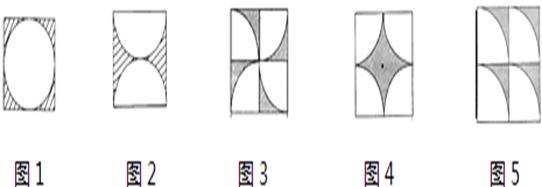

# Mathematics (Grade 6)

**ID**: 1bd21368
**难度**: medium_hard
**题型**: multiple_choice

## 题目
如果正方形的边长相等，下面图形中，对阴影部分的面积描述正确的是（  ）

A．图1和图2大
B．图2和图4大
C．图4和图3大
D．图1和图2一样大

## 解答

**答案**: D

1. Step1:观察图1，图2，图3，图4，图5五个图形，发现它们的空白处均可组成一个完整的半径相等的圆
2. Step2:因为正方形边长相等，所以这五个图形中正方形的面积相等
3. Step3:依据等量减去等量差相等的原理，可知这五个图形中阴影部分的面积相等
4. Step4:根据上述结论，判断选项，得出图1和图2阴影部分面积一样大，所以答案选D

## 知识点

**知识点**:
  - 

---
