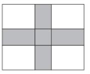

# Mathematics (Grade 6)

**ID**: 1d857a63
**难度**: medium_hard
**题型**: multiple_choice

## 题目
如图，大长方形的长是10厘米，宽是8厘米，阴影部分的宽是2厘米，则空白部分的面积是（）。

A.36平方厘米
B.40平方厘米
C.48平方厘米

## 解答

**答案**: C

1. Step1:根据平移法，将水平方向的阴影向下平移，竖直方向的阴影向左平移，把空白部分组成一个规则图形
2. Step2:计算平移后长方形的长，由大长方形长10厘米，阴影部分宽2厘米，可得长为10 - 2 = 8厘米
3. Step3:计算平移后长方形的宽，由大长方形宽8厘米，阴影部分宽2厘米，可得宽为8 - 2 = 6厘米
4. Step4:根据长方形面积公式“长方形的面积=长×宽”，计算空白部分面积为8×6 = 48平方厘米
5. Step5:对比选项，得出答案为C

## 知识点

**知识点**:
  - 长方形与正方形的面积;平移法求组合图形的面积(奥数)

---
