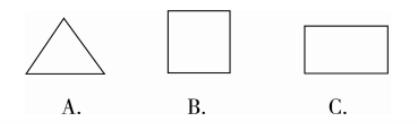

# Mathematics (Grade 6)

**ID**: 1e380be0
**难度**: medium_hard
**题型**: multiple_choice

## 题目
下面图形中，对称轴条数最多的是（）

## 解答

**答案**: B

1. Step1:明确轴对称图形定义为在一个平面内，沿一条直线折叠，直线两旁部分能完全重合的图形
2. Step2:分析A选项等边三角形，得出其有三条对称轴
3. Step3:分析B选项正方形，得出其有四条对称轴
4. Step4:分析C选项长方形，得出其有两条对称轴
5. Step5:比较三个图形对称轴数量，4＞3＞2，可知正方形对称轴最多，所以答案选B

## 知识点

**知识点**:
  - 轴对称

---
