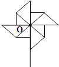

# Mathematics (Grade 6)

**ID**: 1fcfadc0
**难度**: medium_hard
**题型**: multiple_choice

## 题目
如图风车绕点O旋转一定角度后能与自身重合，则旋转的角度可能是（  ）

A．30°
B．45°
C．90°
D．135°

## 解答

**答案**: C

1. Step1:观察图形可知，风车可平分成4部分
2. Step2:根据旋转对称图形的性质，旋转角度应为360°除以平分的份数
3. Step3:计算360°÷4 = 90°，即旋转90°或90°的整数倍能与自身重合
4. Step4:对比选项，只有C选项90°符合

## 知识点

**知识点**:
  - 旋转．

---
