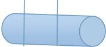

# Mathematics (Grade 6)

**ID**: 20dba329
**难度**: medium_hard
**题型**: multiple_choice

## 题目
如图所示，把一根长2米、底面积是40平方厘米的圆柱形木料截成3段，表面积增加了（  ）平方厘米．

$\begin{description}
\item A．240\item B．80\item C．120\item D．160
\end{description}$

## 解答

**答案**: D

1. Step1:明确把圆柱形木料截成3段的情况，根据解析2可知，截成3段时，表面积增加的部分是4个圆柱的底面的面积。
2. Step2:已知圆柱的底面积是40平方厘米，要计算增加的表面积，根据上述结论，用底面积乘以增加的底面个数，即40×4。
3. Step3:计算40×4的结果为160平方厘米，所以表面积增加了160平方厘米，对应选项D。

## 知识点

**知识点**:
  - 长方体和正方体的表面积；简单的立方体切拼问题．

---
