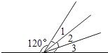

# Mathematics (Grade 6)

**ID**: 21049731
**难度**: medium_hard
**题型**: multiple_choice

## 题目
图中∠1=∠2=∠3，那么∠1=（ ）

A．10°
B．20°
C．30°
D．40°

## 解答

**答案**: B

1. Step1:根据平角的定义，可知平角为180°，所以∠1、∠2、∠3与120°角组成平角，可得出∠1+∠2+∠3 = 180° - 120°
2. Step2:因为∠1=∠2=∠3，所以3∠1 = 180° - 120°
3. Step3:计算180° - 120°的结果为60°，即3∠1 = 60°
4. Step4:求解∠1，∠1 = 60°÷3 = 20°
5. Step5:根据计算结果，对比选项，答案为B

## 知识点

**知识点**:
  - 

---
