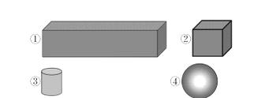

# Mathematics (Grade 6)

**ID**: 260317d5
**难度**: medium_hard
**题型**: multiple_choice

## 题目
从下面（）图形上看不到正方形。

## 解答

**答案**: ④

1. Step1:分析图形①，它是长方体，从左侧看能看到正方形
2. Step2:分析图形②，它从前后左右上看到的都是正方形
3. Step3:分析图形③，它从侧面看能看到正方形
4. Step4:分析图形④，它是球体，无论从哪个方向看都是圆形，看不到正方形
5. Step5:得出从图形④上看不到正方形的结论

## 知识点

**知识点**:
  - 从不同位置观察立体图形

---
