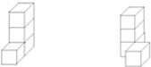

# Mathematics (Grade 6)

**ID**: 26396a77
**难度**: medium_hard
**题型**: multiple_choice

## 题目
从（  ）面看，看到的形状完全相同．

A．正面
B．侧面
C．上面

## 解答

**答案**: B

1. Step1:观察图形，确定需要分析从正面、侧面、上面看的形状
2. Step2:分析从正面看的形状，第一个图形是1列，第二个图形是2列
3. Step3:分析从上面看的形状，第一个图形是2行1列，第二个图形是2行2列
4. Step4:分析从侧面看的形状，都是2列，左边一列是3个正方形，右边一列是1个正方形
5. Step5:对比从三个方向看到的形状，得出从侧面看到的形状完全相同

## 知识点

**知识点**:
  - 从不同方向观察物体和几何体．

---
