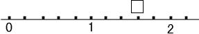

# Mathematics (Grade 6)

**ID**: 26ad44f0
**难度**: medium_hard
**题型**: multiple_choice

## 题目
图上□里的数是（  ）
A．\frac{7}{10}
B．\frac{2}{5}
C．$1\frac{3}{5}$
D．\frac{7}{5}

## 解答

**答案**: C

1. Step1:明确在数轴上每个单位长度被平均分成了5份，每份占它的1/5
2. Step2:观察到□所在位置大于1，处在1和2之间的第三份处
3. Step3:得出□表示的数是1又3/5
4. Step4:对比选项，发现C选项为1又3/5，所以答案是C

## 知识点

**知识点**:
  - 分数的意义、读写及分类；数轴的认识．

---
