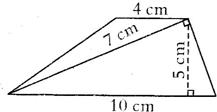

# Mathematics (Grade 6)

**ID**: 2749ede8
**难度**: medium_hard
**题型**: multiple_choice

## 题目
求下图梯形的面积，列式正确的是（  ）

A．（10+4）×7÷2
B．10×4÷2
C．（10十4）×5÷2

## 解答

**答案**: C

1. Step1:明确梯形面积公式为S=(a + b)×h÷2，其中a和b是梯形的上底和下底，h是梯形的高
2. Step2:观察图形可知，梯形的上底为4cm，下底为10cm，高为5cm
3. Step3:将上底4cm、下底10cm、高5cm代入梯形面积公式，得到面积列式为(10 + 4)×5÷2
4. Step4:对比选项，发现C选项的列式(10 + 4)×5÷2与我们根据公式和图形得到的列式一致

## 知识点

**知识点**:
  - 梯形的面积．

---
