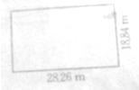

# Mathematics (Grade 6)

**ID**: 286ce939
**难度**: medium_hard
**题型**: multiple_choice

## 题目
有一块长方形铁皮（如图），配上两块（  ）可以做成圆柱．
A．r=4.5m的圆形铁皮
B．d=4.5m的圆形铁皮
C．r=9m的圆形铁皮
D．d=18.84m的圆形铁皮

## 解答

**答案**: A

1. Step1:明确长方形的长是做成圆柱后底面圆的周长，即周长为28.26m
2. Step2:根据圆的周长公式C = 2πr（C为周长，r为半径），已知C = 28.26m，π取3.14，可得r = C÷(2×3.14)，即r = 28.26÷(2×3.14)
3. Step3:计算28.26÷(2×3.14)=28.26÷3.14÷2=9÷2=4.5（m），得到底面圆半径为4.5m
4. Step4:对比选项，半径为4.5m的圆形铁皮符合要求，所以选A

## 知识点

**知识点**:
  - 圆柱的展开图．

---
