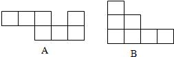

# Mathematics (Grade 6)

**ID**: 2944eea4
**难度**: medium_hard
**题型**: multiple_choice

## 题目
下面说法正确的是(  )

A．面积一样，A的周长大
B．面积一样，B的周长大
C．周长一样，A的面积大
D．周长一样，B的面积大

## 解答

**答案**: A

1. Step1:设每个小正方形的边长为1厘米
2. Step2:数出图A中小正方形的个数为7个，其面积为7×(1×1)=7平方厘米，通过计数其一周边长的数量，得出周长为16厘米
3. Step3:数出图B中小正方形的个数为7个，其面积为7×(1×1)=7平方厘米，通过计数其一周边长的数量，得出周长为14厘米
4. Step4:比较图A和图B的面积，均为7平方厘米，面积相等；比较图A和图B的周长，16厘米大于14厘米，图A的周长大
5. Step5:得出结论，面积一样，A的周长大，答案选A

## 知识点

**知识点**:
  - 面积及面积的大小比较;长度比较．

---
