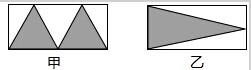

# Mathematics (Grade 6)

**ID**: 29472be5
**难度**: medium_hard
**题型**: multiple_choice

## 题目
如图是两个形状大小完全一样的长方形．比较两幅图的阴影面积，说法正确的是（  ）

A．甲=乙
B．甲＜乙
C．甲＞乙

## 解答

**答案**: A

1. Step1:设两个长方形的长都是a，宽都是b。
2. Step2:计算甲图阴影部分面积，甲图有两个三角形，每个三角形面积为$\frac{1}{2}$a×b÷2，所以甲图阴影部分面积为$\frac{1}{2}$a×b÷2×2=$\frac{1}{2}$ab。
3. Step3:计算乙图阴影部分面积，乙图阴影部分是一个三角形，面积为b×a÷2=$\frac{1}{2}$ab。
4. Step4:比较甲图和乙图阴影部分面积，因为甲图阴影部分面积为$\frac{1}{2}$ab，乙图阴影部分面积也为$\frac{1}{2}$ab，所以甲图的面积=乙图的面积，即一样大，答案选A。

## 知识点

**知识点**:
  - 面积及面积的大小比较．

---
