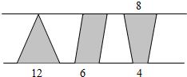

# Mathematics (Grade 6)

**ID**: 299e19f2
**难度**: medium_hard
**题型**: multiple_choice

## 题目
如图是在平行线间的四个图形，他们的面积（  ）

A．角形大
B．平行四边形大
C．梯形大
D．一样大

## 解答

**答案**: D

1. Step1:设两平行线间的距离为h，可知三角形、平行四边形、梯形的高都为h
2. Step2:根据三角形面积公式“三角形的面积=底×高÷2”，计算三角形面积为12×h÷2 = 6h
3. Step3:根据平行四边形面积公式“平行四边形的面积=底×高”，计算平行四边形面积为6×h = 6h
4. Step4:根据梯形面积公式“梯形的面积=(上底+下底)×高÷2”，计算梯形面积为(8 + 4)×h÷2 = 12h÷2 = 6h
5. Step5:比较三个图形的面积，发现都为6h，所以三个图形面积一样大，答案选D

## 知识点

**知识点**:
  - 面积及面积的大小比较．

---
