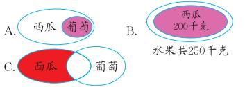

# Mathematics (Grade 6)

**ID**: 2a684bc7
**难度**: medium_hard
**题型**: multiple_choice

## 题目
水果店今天新进葡萄和西瓜共250千克，其中西瓜有200千克。下面图形中能表示这两部分关系的是（）

## 解答

**答案**: B

1. Step1:明确题目条件，已知葡萄和西瓜共250千克，西瓜有200千克
2. Step2:分析选项A，发现其没有明确表示出两部分的数量及总重量关系
3. Step3:分析选项B，看到其明确标出西瓜200千克，水果共250千克，能清晰体现西瓜是250千克中的一部分，进而可推出葡萄为50千克，能清晰表示两部分关系
4. Step4:分析选项C，发现其没有明确表示出两部分的数量及总重量关系
5. Step5:对比三个选项，得出能表示这两部分关系的是B

## 知识点

**知识点**:
  - 物体的比较、排列和分类

---
