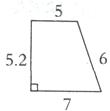

# Mathematics (Grade 6)

**ID**: 2a9bcb0a
**难度**: medium_hard
**题型**: multiple_choice

## 题目
求图中梯形的面积，正确的算式是（  ）

$\begin{description}
\item A．（5+7）×6÷2\item B．（5+7）×5.2\item C．（5+7）×5.2÷2
\end{description}$

## 解答

**答案**: C

1. Step1:明确梯形面积公式为（上底+下底）×高÷2
2. Step2:由图可知梯形上底是5，下底是7，高是5.2
3. Step3:将上底5、下底7、高5.2代入梯形面积公式，得到（5+7）×5.2÷2
4. Step4:对比选项，得出答案为C

## 知识点

**知识点**:
  - 梯形的面积．

---
