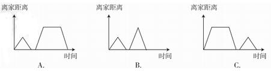

# Mathematics (Grade 6)

**ID**: 2ae8638e
**难度**: medium_hard
**题型**: multiple_choice

## 题目
童童去图书馆借书。他从家出发，走了一段路发现未带借书证，回答拿了借书证立即去了图书馆，在图书馆借了书后就回家。下图（）比较准确地反映了童童的行为。

## 解答

**答案**: A

1. Step1:明确童童的行为过程，先从家出发走一段路，此时离家距离逐渐变远；
2. Step2:发现未带借书证折回，此时离家距离逐渐变近；
3. Step3:拿了借书证再去图书馆，离家距离又逐渐变远；
4. Step4:在图书馆借书时，时间变化但离家距离不变；
5. Step5:借完书回家，离家距离逐渐变近直至为0；
6. Step6:分析选项，A选项符合童童行为中离家距离随时间的变化情况，所以答案是A。

## 知识点

**知识点**:
  - 从统计图表中获取信息

---
