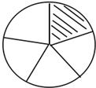

# Mathematics (Grade 6)

**ID**: 2aebf308
**难度**: medium_hard
**题型**: multiple_choice

## 题目
图中阴影面积占全部面积的（  ）

$\begin{description}
\item A．20\%\item B．25\%\item C．30\%
\end{description}$

## 解答

**答案**: A

1. Step1:观察图形可知，整个圆被平均分成了5份
2. Step2:阴影部分占其中的1份
3. Step3:所以阴影面积占全部面积的比例为1÷5 = $rac{1}{5}$
4. Step4:将$rac{1}{5}$转化为百分数，即$rac{1}{5}$×100% = 20%
5. Step5:对比选项，答案是A

## 知识点

**知识点**:
  - 分数的意义、读写及分类．

---
